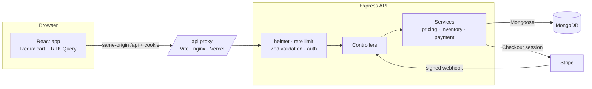

# ShopSphere

[](https://github.com/keerthanan2211/shopsphere/actions/workflows/ci.yml) [](LICENSE)

A full-stack MERN e-commerce store for handcrafted Indian home goods: block-printed textiles from Kutch, brass from Moradabad, blue pottery from Jaipur. Customers browse, filter, review and buy; admins manage products, stock and order fulfilment.

**Stack:** MongoDB · Express · React · Node.js · Redux Toolkit (RTK Query) · Tailwind CSS · Stripe · Docker · GitHub Actions

**Demo accounts** (created by the seed script):

- Customer: `customer@shopsphere.dev` / `Shop#2026`
- Admin: `admin@shopsphere.dev` / `Admin#2026`

---

## Contents

- [Features](#features)
- [Tech stack](#tech-stack)
- [Architecture](#architecture)
- [Project structure](#project-structure)
- [Getting started](#getting-started)
- [Environment variables](#environment-variables)
- [Payments: mock and Stripe](#payments-mock-and-stripe)
- [API reference](#api-reference)
- [Engineering decisions](#engineering-decisions)
- [Testing](#testing)
- [Deployment](#deployment)
- [Roadmap](#roadmap)

---

## Features

**Shopping**
- Product catalogue with full-text search, category filters, sorting and pagination
- Filters stored in the URL (`?category=ceramics&sort=price-asc`), so results are shareable and survive refresh
- Product pages with origin, stock warnings ("Only 3 left") and customer reviews with star ratings
- Cart with quantity limits based on live stock, saved across visits
- Checkout with Indian address validation (6-digit PIN, 10-digit mobile)
- 12% GST, free shipping over ₹999, and an order timeline from placed to delivered
- Customers can cancel orders before shipping, and stock is returned automatically

**Admin**
- Dashboard: revenue, orders waiting to ship, customer count, recent orders and low-stock alerts
- Product management: create, edit and delete products, set price, stock and images
- Order fulfilment: move orders through paid, shipped and delivered, with only valid next steps shown

**Payments**
- **Mock mode** (default): a "Pay (demo)" button, so the full flow works with no API keys
- **Stripe mode**: Stripe Checkout in test mode, confirmed by a signature-verified webhook

**Security**
- JWT stored in an **httpOnly cookie**, so page scripts can't read it
- Passwords hashed with bcrypt; password hashes are never returned by queries
- Prices always recalculated on the server from the database: the client can't change what it pays
- Stock reserved with atomic conditional updates, so two shoppers can't buy the last item
- Zod validation on every input, Helmet security headers, and rate-limited login and registration
- Customers can only see their own orders; anything else returns 404

**Accessibility**
- Skip link, labelled forms with linked error messages, and focus moved to the first invalid field
- Star rating input built on radio buttons, so it works with keyboard and screen readers
- Visible focus styles, reduced-motion support, and status messages announced with `aria-live`

---

## Tech stack

| Layer | Technology | Why |
| --- | --- | --- |
| Frontend | React 18 + Vite | Fast dev server and optimised production builds |
| State | Redux Toolkit | Predictable cart state with a simple, testable reducer |
| Data fetching | RTK Query | Caching, loading states, and refetching after mutations through cache tags |
| Routing | React Router 6 | Nested layouts and route guards for signed-in and admin pages |
| Styling | Tailwind CSS | Utility classes with a small, custom colour palette |
| Backend | Node.js 20 + Express 4 | Minimal, well-known HTTP framework |
| Database | MongoDB + Mongoose | Flexible documents for products with embedded reviews |
| Validation | Zod | One schema library for env vars, requests and query strings |
| Auth | JWT in httpOnly cookies + bcrypt | Sessions that are safe from XSS token theft |
| Payments | Stripe Checkout + webhooks | Hosted, PCI-compliant payment page |
| Testing | Vitest + Supertest | Fast unit and HTTP tests |
| DevOps | Docker, Docker Compose, nginx, GitHub Actions | One-command stack and CI on every push |

---

## Architecture



**How checkout works:**

1. The browser sends only product IDs and quantities, never prices.
2. The server loads those products from MongoDB and calculates subtotal, shipping, GST and total.
3. Stock is reserved with an atomic `updateOne({ stock: { $gte: qty } }, { $inc: { stock: -qty } })` per item. If any item is short, everything already reserved is released.
4. An order is created with status `pending`.
5. In Stripe mode, the server creates a Checkout session and the browser is redirected to Stripe. In mock mode, the order page shows a demo pay button.
6. Stripe calls the webhook. The server verifies the signature and marks the order `paid`. Repeat deliveries of the same event are ignored.

---

## Project structure

```
shopsphere/
├── server/                        Express API
│   ├── src/
│   │   ├── config/                Env validation (Zod) and MongoDB connection
│   │   ├── models/                User, Product (with reviews), Order
│   │   ├── middleware/            Auth guards, request validation, error handler
│   │   ├── controllers/           Auth, products, orders, admin
│   │   ├── routes/                Express routers
│   │   ├── services/              pricing.js, inventory.js, payment.js
│   │   ├── validators/            Zod request schemas
│   │   ├── seed/                  Demo products and accounts
│   │   ├── app.js                 Express app (exported for tests)
│   │   └── server.js              Starts the server, graceful shutdown
│   └── tests/                     Pricing, order status and API tests
├── client/                        React app
│   ├── src/
│   │   ├── app/store.js           Redux store, cart persistence
│   │   ├── features/api/          RTK Query endpoints
│   │   ├── features/cart/         Cart slice and tests
│   │   ├── components/            Layout, product card, ratings, guards, pattern tiles
│   │   ├── pages/                 Shop, product, cart, checkout, orders, auth
│   │   ├── pages/admin/           Dashboard, products, orders
│   │   └── utils/                 Currency, dates, totals
│   ├── nginx.conf                 Serves the app and proxies /api in Docker
│   └── vercel.json                Same-origin /api rewrite for Vercel
├── .github/workflows/ci.yml
└── docker-compose.yml
```

---

## Getting started

### Option 1: Docker

```bash
git clone https://github.com/keerthanan2211/shopsphere.git
cd shopsphere
docker compose up --build
docker compose exec server npm run seed:prod     # in a second terminal
```

Open **http://localhost:8080** and sign in with a demo account.

### Option 2: Run locally

**Prerequisites:** Node.js 20.6+ and MongoDB, either installed locally or a free [MongoDB Atlas](https://www.mongodb.com/atlas) cluster.

```bash
git clone https://github.com/keerthanan2211/shopsphere.git
cd shopsphere
npm run install:all

cp server/.env.example server/.env    # then set MONGODB_URI and JWT_SECRET
npm run seed                          # demo products and accounts

npm run dev:server                    # http://localhost:5000
npm run dev:client                    # http://localhost:5173 (second terminal)
```

Vite proxies `/api` to the Express server, so the session cookie works without any CORS setup.

---

## Environment variables

### Server (`server/.env`)

| Variable | Example | Description |
| --- | --- | --- |
| `MONGODB_URI` | `mongodb://127.0.0.1:27017/shopsphere` | MongoDB connection string |
| `JWT_SECRET` | `3f9a…` | Secret for signing session tokens (at least 16 characters) |
| `JWT_EXPIRES_IN` | `7d` | Session length |
| `PORT` | `5000` | API port |
| `CLIENT_URL` | `http://localhost:5173` | Used for CORS and Stripe redirect URLs |
| `PAYMENT_MODE` | `mock` or `stripe` | Which payment flow to use |
| `STRIPE_SECRET_KEY` | `sk_test_…` | Required when `PAYMENT_MODE=stripe` |
| `STRIPE_WEBHOOK_SECRET` | `whsec_…` | Required when `PAYMENT_MODE=stripe` |
| `COOKIE_SECURE` | `false` | Optional. Defaults to `true` in production |

The server validates these on startup and exits with a clear message if anything is missing.

### Client

| Variable | Description |
| --- | --- |
| `VITE_API_URL` | Leave empty. The app always calls `/api` on its own origin through a proxy. |

---

## Payments: mock and Stripe

**Mock mode** needs nothing. After placing an order, click **Pay (demo)** on the order page.

**Stripe test mode:**

1. Create a free [Stripe](https://dashboard.stripe.com/register) account and copy your **test** secret key.
2. Install the [Stripe CLI](https://stripe.com/docs/stripe-cli) and forward webhooks locally:
   ```bash
   stripe listen --forward-to localhost:5000/api/payments/webhook
   ```
   It prints a `whsec_…` signing secret.
3. In `server/.env` set `PAYMENT_MODE=stripe`, `STRIPE_SECRET_KEY` and `STRIPE_WEBHOOK_SECRET`.
4. Pay with the test card `4242 4242 4242 4242`, any future date and any CVC.

---

## API reference

All routes are under `/api`. Routes marked 🔒 need a signed-in session; 🛡️ need an admin.

| Method | Route | Description |
| --- | --- | --- |
| `POST` | `/auth/register` | Create an account and start a session |
| `POST` | `/auth/login` | Sign in |
| `POST` | `/auth/logout` | End the session |
| `GET` | `/auth/me` 🔒 | Current user |
| `GET` | `/products` | List with `search`, `category`, `minPrice`, `maxPrice`, `sort`, `page`, `limit` |
| `GET` | `/products/:slug` | One product with reviews |
| `POST` | `/products/:id/reviews` 🔒 | Add a review (one per customer) |
| `POST` | `/products` 🛡️ | Create a product |
| `PATCH` | `/products/:id` 🛡️ | Update a product |
| `DELETE` | `/products/:id` 🛡️ | Delete a product |
| `POST` | `/orders` 🔒 | Place an order: `{ items: [{ productId, quantity }], shippingAddress }` |
| `GET` | `/orders/mine` 🔒 | Your orders |
| `GET` | `/orders/:id` 🔒 | One order (yours, or any for admins) |
| `POST` | `/orders/:id/pay` 🔒 | Demo payment (mock mode only) |
| `POST` | `/orders/:id/cancel` 🔒 | Cancel before shipping; returns stock |
| `GET` | `/admin/stats` 🛡️ | Dashboard numbers |
| `GET` | `/admin/orders` 🛡️ | All orders, optional `?status=` |
| `PATCH` | `/admin/orders/:id/status` 🛡️ | Move an order to its next status |
| `POST` | `/payments/webhook` | Stripe webhook (signature verified) |
| `GET` | `/health` | API and database status |

Errors always look like `{ "message": "…", "details": [{ "field": "…", "message": "…" }] }`.

---

## Engineering decisions

**Money as integers.** Prices are stored in paise (`249900` = ₹2,499), so totals never suffer floating-point rounding errors.

**The server owns prices.** The cart keeps a price snapshot for display, but `POST /orders` accepts only IDs and quantities and re-prices everything from MongoDB.

**Race-free stock.** Stock is reserved with a conditional atomic update rather than "read, check, then write", which would let two simultaneous checkouts both buy the last item.

**Order history is immutable.** Each order copies the product name and price at purchase time, so editing or deleting a product never changes past orders.

**Safe status changes.** Orders follow an explicit state machine (`pending → paid → shipped → delivered`, with cancellation before shipping). Invalid jumps are rejected by the server, and the admin UI only offers valid next steps.

**Same-origin API everywhere.** The browser always calls `/api` on its own origin (proxied by Vite, nginx or Vercel), so the httpOnly cookie works without relying on third-party cookies, which browsers increasingly block.

**Fail fast on config.** Environment variables are validated with Zod on startup, so a missing secret stops the server immediately with a clear message.

---

## Testing

```bash
npm test
```

- **Server (16 tests):** pricing, GST and free-shipping rules, line merging, the order status state machine, and HTTP tests with Supertest (validation errors, auth guards, forged cookies, 404s, security headers)
- **Client (7 tests):** cart reducer: stock caps, quantity limits, removal, totals

CI runs lint, tests and a production build on every push and pull request.

---

## Deployment

| Part | Service | Notes |
| --- | --- | --- |
| Database | [MongoDB Atlas](https://www.mongodb.com/atlas) (free M0) | Copy the connection string into `MONGODB_URI` |
| API | [Render](https://render.com) | New Web Service, root `server`, build `npm ci`, start `npm start`. Set the env vars. |
| Frontend | [Vercel](https://vercel.com) | Root `client`. Edit `client/vercel.json` to point `/api` at your Render URL. |

Then:
1. Set `CLIENT_URL` on Render to your Vercel URL.
2. Run `npm run seed:prod` once from the Render shell.
3. For Stripe, add a webhook in the Stripe dashboard pointing to `https://<your-api>.onrender.com/api/payments/webhook`.

---

## Roadmap

- Image uploads to Cloudinary or S3
- Wishlist and saved addresses
- Order confirmation emails
- Coupon codes
- End-to-end tests with Playwright

---

## License

MIT. Built by **Nichenametla Keerthana** · [LinkedIn](https://www.linkedin.com/in/nichenametla-keerthana/)
